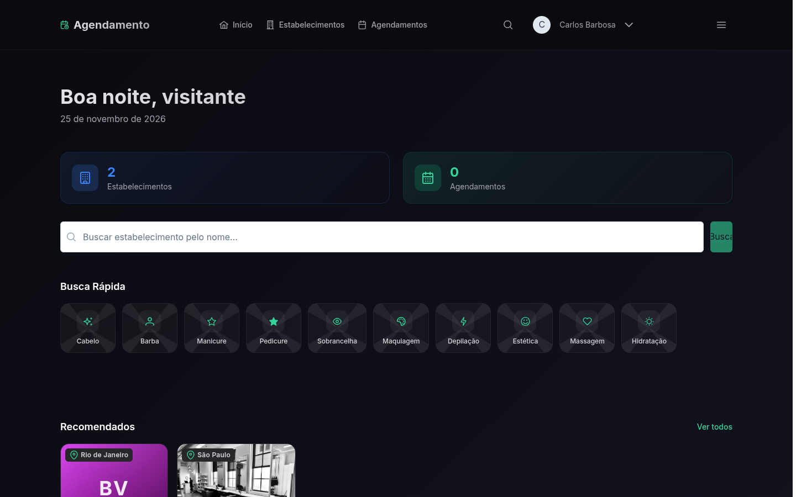
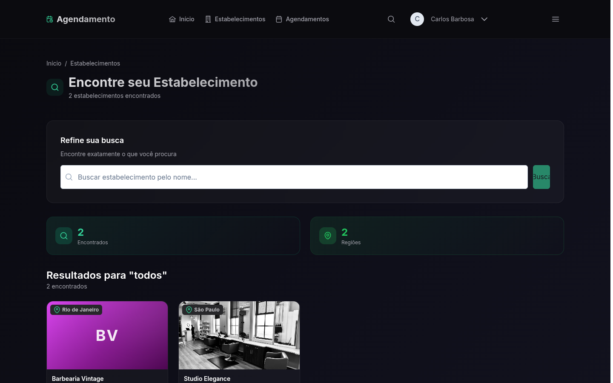
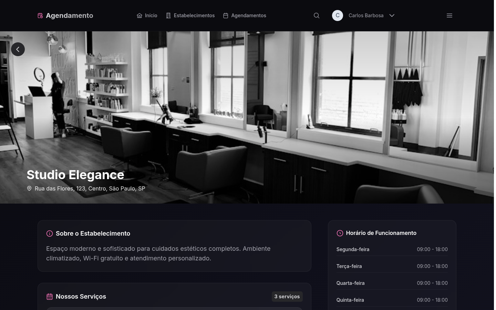
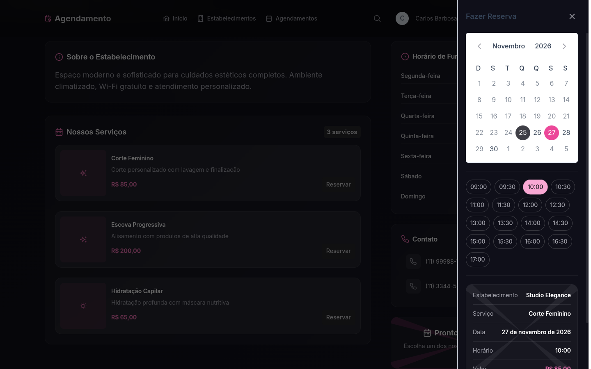
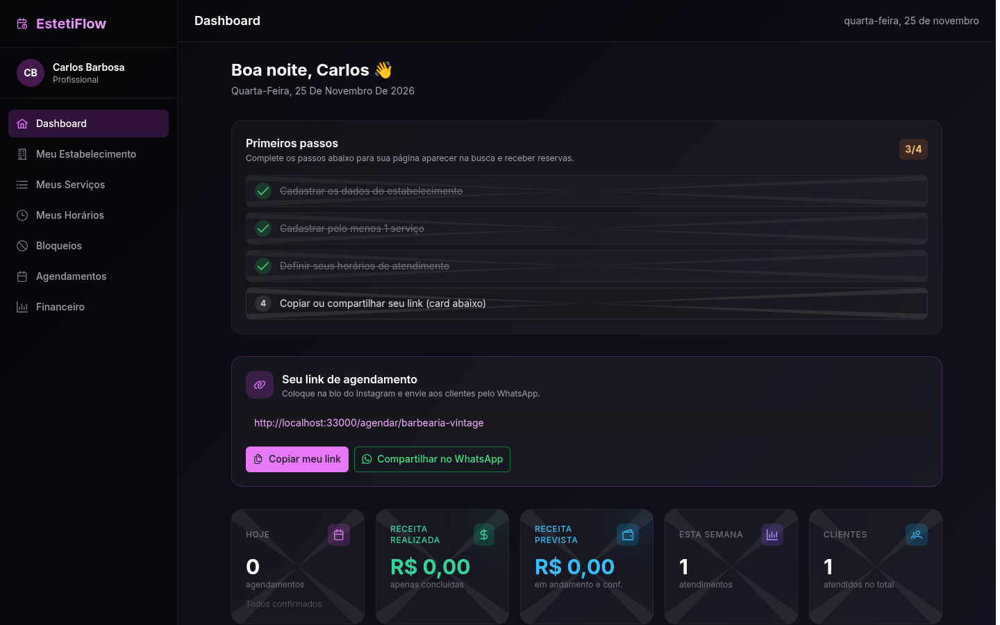
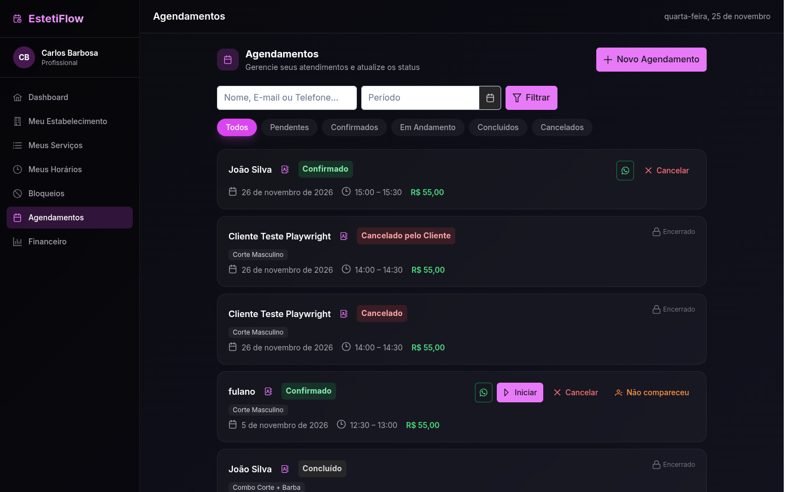
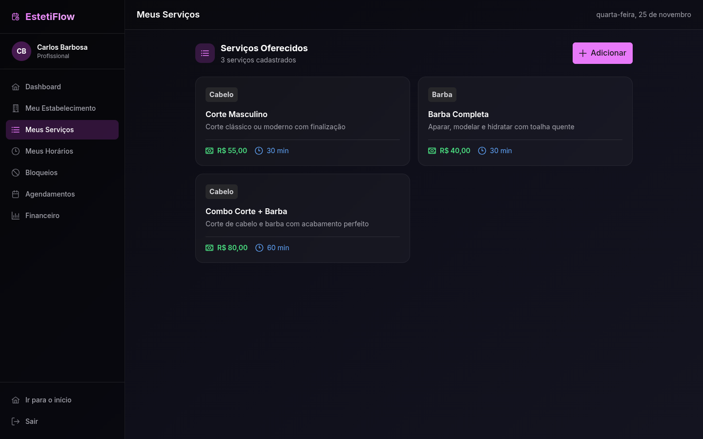
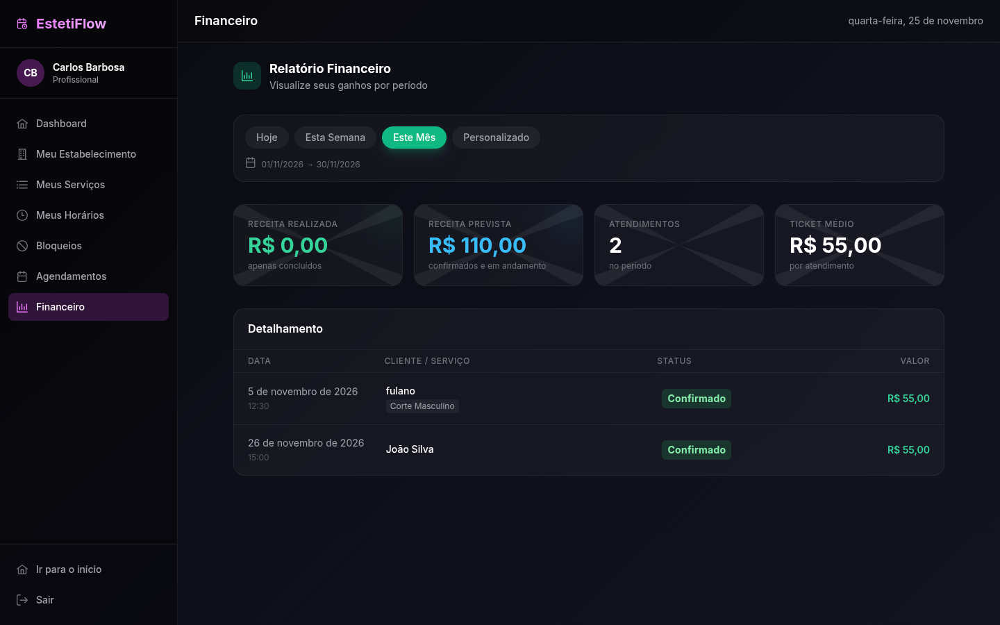

# EstetiFlow — SaaS de Agendamento para Serviços Estéticos

Plataforma SaaS para agendamento de serviços estéticos (barbearias, salões, clínicas, etc.) com gestão completa para profissionais e experiência de agendamento fluida para clientes.

---

## 📸 Telas

### Área do cliente

| Home | Busca de estabelecimentos |
|------|---------------------------|
|  |  |
| Saudação, busca e atalhos por categoria de serviço. | Busca por nome com cards de estabelecimentos por região. |

| Página pública do estabelecimento | Fluxo de reserva |
|-----------------------------------|------------------|
|  |  |
| Link próprio (`/agendar/{slug}`) com serviços, horários de funcionamento e contato. | Escolha de data, horários livres e resumo antes de confirmar. |

### Painel do profissional

| Dashboard | Agendamentos |
|-----------|--------------|
|  |  |
| Primeiros passos, link de agendamento para compartilhar e indicadores do dia. | Filtros por status e período, ações de iniciar, cancelar, não compareceu e WhatsApp. |

| Serviços | Financeiro |
|----------|------------|
|  |  |
| Cadastro de serviços com categoria, preço e duração. | Receita realizada x prevista, ticket médio e detalhamento por período. |

---

## 🛠️ Stack Tecnológica

| Camada | Tecnologia |
|--------|-----------| 
| **Frontend** | Vue 3 (Composition API) + Inertia.js + PrimeVue 4 (Aura) + Tailwind CSS |
| **Backend** | Laravel 11 (monolito com Inertia) |
| **Banco** | MySQL 8.0 (14 tabelas, 5 módulos) |
| **Auth** | Sessão Laravel + Spatie Permission (3 roles) |
| **Infra** | Docker Compose (6 containers) |

---

## 🐳 Setup com Docker

### Pré-requisitos
- Docker + Docker Compose

### Subir o ambiente

```bash
docker compose up -d
```

### Acessar o container Node (para npm)

```bash
docker compose exec node sh
```

### Comandos úteis dentro do container

```bash
# Instalar dependências
npm install

# Dev server (Vite)
npm run dev

# Build produção
npm run build
```

### Acessar o container PHP (para artisan)

```bash
docker compose exec app sh
```

### Comandos artisan úteis

```bash
# Rodar migrations
php artisan migrate

# Rodar seeders (dados de teste)
php artisan db:seed

# Resetar banco (⚠️ apaga tudo)
php artisan migrate:fresh --seed

# Listar rotas
php artisan route:list
```

---

## 📂 Estrutura de Pastas

```
app/Http/Controllers/       # Controllers Laravel (Auth/, Profissional/)
app/Models/                 # Eloquent Models (14 tabelas)
app/Services/               # Business logic (Agendamento, Estabelecimento)
routes/web.php              # Rotas Inertia
resources/js/
├── Components/             # Componentes Vue (Features/, Layout/, Profissional/)
├── Constants/              # Constantes (categorias, etc.)
├── Layouts/                # DefaultLayout, AuthLayout, DashboardLayout
├── Pages/                  # Páginas Inertia (Home, Login, Profissional/, etc.)
└── Utils/                  # Utilidades (formatters)
```

---

## 📖 Documentação Técnica

A documentação completa e centralizada do projeto está em:

> **`.agents/docs/PROJETO.md`** — Fonte de verdade para todo o contexto técnico.

### Índice de Seções

| # | Seção | O que contém |
|---|-------|-------------|
| 1 | [Visão Geral do Produto](.agents/docs/PROJETO.md#1-visão-geral-do-produto) | Modelo de negócio, funcionalidades do MVP, features futuras |
| 2 | [Stack Tecnológica](.agents/docs/PROJETO.md#2-stack-tecnológica) | Tabela completa de tecnologias por camada |
| 3 | [Arquitetura e Estrutura](.agents/docs/PROJETO.md#3-arquitetura-e-estrutura-de-pastas) | Fluxo de dados, árvore de pastas, menu do painel |
| 4 | [Padrões de Código](.agents/docs/PROJETO.md#4-padrões-de-código) | Nomenclatura, Vue 3 + Inertia, Service Pattern, Auth |
| 5 | [Fluxo de Agendamento](.agents/docs/PROJETO.md#5-fluxo-de-agendamento) | Diagrama de status, transições, regras de exibição, tabelas |
| 6 | [Estado Atual](.agents/docs/PROJETO.md#6-estado-atual--implementado-vs-pendente) | Implementado ✅ vs Parcial ⚠️ vs Pendente ❌ |
| 7 | [Roadmap](.agents/docs/PROJETO.md#7-roadmap-de-implementação) | Fases de implementação com prioridades |
| 8 | [Decisões Técnicas](.agents/docs/PROJETO.md#8-decisões-técnicas-registradas) | Trade-offs e escolhas arquiteturais |
| 9 | [Referências](.agents/docs/PROJETO.md#9-referências) | Links para schema do banco, guias, rules |

### Documentação Complementar

| Documento | Caminho | Conteúdo |
|-----------|---------|----------|
| **Schema de Banco** | `.agents/skills/saas-database-schema/SKILL.md` | 14 tabelas com tipos, relacionamentos e regras |
| **Arquitetura de Banco** | `.agents/skills/database-architect/SKILL.md` | Metodologia de modelagem MySQL/MariaDB |
